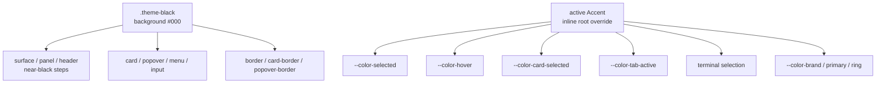

# Black Theme

**Status:** active  
**Owner:** UI theme and Appearance maintainers  
**Authority:** contract  
**Scope:** Black theme token coverage and accent compatibility  
**Updated:** 2026-10-12 08:39 (local time)  
**Verification:** source-only documentation review; visual acceptance remains a separate check

Related: [theme catalog](../theme-catalog.md), [accent selection](accent-picker.md). The superseded theme-reduction specification is historical context, not a dependency.

## Problem

`black` is the pure-black OLED surface theme, but its CSS block only overrides the
six background-family tokens plus four brand tokens. Every other token keeps the
`.dark` value, which is built on `--color-neutral-900`.

Concrete defects this produces:

- `--color-hover` / `--color-surface-hover` derive from `--color-neutral-800`, so hover
  states on a `#000` page are grey and do not read as "black surface + lift".
- `--color-selection` on rows and list items is a flat white 10% mix, so selection does
  not carry the accent family the product just established.
- Elements that sit directly on the page (`--color-background`) have no defined
  elevation step: the card is `#111`, but surface, panel, header, and card borders
  were never re-derived, so layering is inconsistent.
- Terminal background/foreground are not pinned to black surfaces, so the terminal
  panel is grey in Black.

`black` therefore behaves like "dark with a darker background" rather than a theme
with its own surface model. "Fully support black mode" means the pure-black surface
has to be coherent across every token the app consumes, not only the page background.

## Product rules

1. **Black is a complete surface set.** `black` defines its own background family
   (background, background-alt, header, panel, sidebar, surface, card, popover,
   input, menu, tab) on a black base. No token in the block may inherit a grey
   `neutral-800/900` value that would look wrong on a `#000` page.
2. **Elevation is expressed by near-black steps, not grey.** The black theme uses
   `#000` for the page and small near-black steps for containers so panels separate
   without becoming grey.
3. **Accent still participates.** Selection, hover-lift, cards selected, and the
   accent surface follow the active accent through the same semantic tokens the picker
   writes (`--color-selected`, `--color-card-selected`, `--color-accent`,
   `--color-tab-active`).
4. **The saved accent wins over the theme default.** The theme block provides the teal
   fallback; an explicitly chosen accent overrides it. Switching to Black never resets
   the chosen accent, and choosing an accent never changes the Black surfaces.
5. **Semantic status colors are unchanged.** Success / warning / destructive / diff
   keep the dark-base values; the black theme does not invent new status colors.
6. **Contrast holds.** Text, borders, cards, popovers, and inputs keep readable
   contrast against their black surfaces.

## State owner

- `packages/ui/src/styles.css` owns the `.theme-black` token block. It is the single
  place that defines black surfaces, and it may only be changed there.
- `packages/ui/src/accent.ts` owns the accent-derived tokens that are applied as root
  inline overrides. The black theme must not re-declare a token that the accent writes
  with `!important` or a later cascade layer, or the accent would silently stop working.
- `packages/ui/src/useTheme.ts` is unchanged; `black` already resolves to a dark theme.

## Token relationship

## Acceptance scenarios

1. Selecting Black paints a `#000` page and every container uses a near-black step;
   no container falls back to the grey `neutral-800` family.
2. Hover and selection on task rows, list items, menu items, and tabs are visually
   distinct from the black background and carry the selected accent.
3. Cards, popovers, menus, inputs, headers, panels, and sidebars remain readable and
   clearly layered against the page.
4. The terminal panel is black-on-black-surface rather than grey.
5. Choosing an accent (for example Rose) and then selecting Black keeps the Rose
   accent on hover, selection, focus rings, and primary buttons.
6. Success / warning / destructive / diff colors in Black match the dark theme values.
7. Switching Black → Light → Black does not lose the stored accent or theme.

## Verification

- After implementation changes, run `pnpm typecheck`, `pnpm lint`, and `pnpm architecture:check --changed`; record actual results in the [verification log](../verification-log.md).
- Verify Black visually in an isolated running app. Stylesheet presence does not prove contrast, elevation, or terminal rendering. No runtime check was run for this documentation review.
