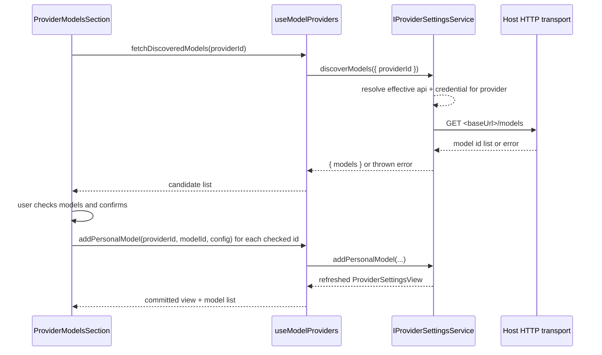

# Custom provider model discovery

**Status:** active  
**Owner:** Model settings and provider service maintainers  
**Authority:** contract  
**Scope:** read-only provider catalog discovery and selected personal-model additions  
**Updated:** 2026-10-12 08:39 (local time)  
**Verification:** source-only review; request-count and error-display limitations remain below

## Product behavior

Custom providers can discover their model list from the provider's own `/models`
endpoint instead of requiring the user to type every model ID by hand.

- The provider detail page offers a **Fetch models** action next to **Add model**.
- Fetching calls the provider endpoint derived from the provider's effective Base URL
  and API type, using the provider's stored credential. It is a read-only probe; it
  never writes provider or model configuration.
- The response is shown as a checklist. Every discovered model ID is listed with a
  checkbox. Model IDs already present in the provider (built-in or personal) are
  shown as already added and cannot be selected again.
- The user selects which discovered models to add and confirms. Only the selected
  model IDs are persisted as personal models.
- Manual entry through **Add model** remains available and unchanged. Discovery never
  removes or replaces manual entry.
- After a discovered model is added, it behaves exactly like a manually added model:
  smart configuration, metadata editing, connectivity test, enable/disable, reorder,
  and deletion all apply.
- Selecting **Add** with nothing checked is rejected without a write.
- Discovery failures (network error, non-2xx response, unrecognizable body) surface an
  inline error message and leave configuration untouched.
- When discovery returns no model IDs, the dialog shows an English empty state.
- Opening the dialog issues exactly one discovery request per opening, plus one more
  if the provider's model list changes while the dialog stays open. The probe must
  not be re-triggered by re-renders: it is keyed on the provider identity and the
  content of the already-added model IDs, never on array or `Set` object identity.
  A provider that answers in a few hundred milliseconds must settle the dialog in
  that time rather than leaving it on its loading state.

## Ownership and boundary

`ProviderModelsSection` in `packages/ui/src/settings/model-provider-section/ProviderCardSections.tsx`
remains the single UI owner of the model list surface. `ModelProviderSection` and
`useModelProviders` remain the owner of the provider view, its revision, and the
model-membership write path.

Discovery is a new read-only operation on `IProviderSettingsService`
(`ServiceChannels.ProviderSettings`). It is a sibling of `testModelConnectivity`:

- It resolves the provider's effective API endpoint and credential inside the
  Environment that owns the provider config, so remote Environments probe their own
  endpoint with their own credential.
- It does not write to the provider config, does not bump the settings revision, and
  does not emit `onDidChange`.
- Adding the selected models reuses the existing `addPersonalModel` mutation path. No
  second persistence path is introduced; membership stays owned by
  `personalModelIds` plus `modelOrder`.
- The UI is a bounded overlay: it holds only the discovered candidate list, the
  checked set, and pending/failed status. It does not cache discoveries across
  provider switches.

The Desktop-to-Agent protocol does not change for catalog discovery. The Host service
composition in `packages/services/src/node.ts` injects its `apiClient` into
`createModelDiscoveryExecutor`. Model connectivity is separate: the connectivity
tester delegates a persisted selection to the Agent service's formal model test.
A catalog GET is not equivalent to that generation/connectivity path.

## Event order

Adding discovered models is sequential and idempotent per model ID: a repeated add for
an already-present ID is a no-op in the existing mutation path. The overlay closes only
after every selected model has been committed or reported failed.

The probe is triggered by opening the dialog, not by rendering it. The dialog derives
its request key from the provider identity and the content of the already-added IDs, so
a re-render — including one caused by its own loading-state update — cannot restart the
request. The request carries the service-layer timeout, so a hanging endpoint settles as
an inline error instead of an indefinite loading state.

## Current source and review procedure

Read these owners before investigating a discovery failure:

- [`ProviderModelDiscoveryDialog.tsx`](../../packages/ui/src/settings/model-provider-section/ProviderModelDiscoveryDialog.tsx): request token, content-based existing-ID key, checkbox state, retry, and Add.
- [`InlineEditableProviderCard.tsx`](../../packages/ui/src/settings/model-provider-section/InlineEditableProviderCard.tsx): serial `onAddPersonalModel` calls and provider-scoped callbacks.
- [`providerFacadeServices.ts`](../../packages/services/src/model-provider/providerFacadeServices.ts): service admission and persisted provider ownership.
- [`modelDiscoveryExecutor.ts`](../../packages/services/src/model-provider/modelDiscoveryExecutor.ts): enabled-provider check, effective facts, headers, and GET request with a 15,000 ms timeout.
- [`modelCatalogDiscovery.ts`](../../packages/services/src/model-provider/modelCatalogDiscovery.ts): public discovery result and provider-helper re-exports.

Fetch uses saved configuration, not unapplied Base URL/API-key drafts. Apply first
when deliberately testing a changed endpoint. Discovery and Test are distinct
manual reads; see [Apply/Test](custom-provider-connection-apply-and-test.md) for the
remaining implicit-save mismatch.

The dialog preselects new IDs; already-added IDs are checked and disabled. Opening,
explicit Retry, or a changed existing-ID content key starts a probe. Ordinary
rerenders with the same key do not. Sequential additions can change that key more
than once while the dialog is open, so the source does not establish a single
extra request for an entire multi-model import. Keep the request-count requirement
above pending interaction verification rather than claiming it passed.

Two desired outcomes remain mismatched: empty selection disables Add/returns
without a validation message; an Add failure sets `errorMessage` while `phase`
remains `ready`, but the rendered alert belongs to `phase === "failed"` (probe
failure). Thus an import error is not guaranteed visible. Earlier successful
serial additions are already committed when a later addition fails; discovery
itself is read-only, but the import is not an all-or-nothing transaction.

Existing focused tests are `packages/services/test/modelCatalogDiscovery.test.ts`,
`packages/ui/test/modelDiscoveryProbeLoop.test.ts`, and
`packages/ui/test/modelDiscoveryStableIdentity.test.ts`. They were not rerun in
this docs-only review. A future isolated interaction check should count requests
on open/rerender/Retry/import, verify the disabled already-added IDs, then exercise
empty selection, empty catalog, malformed response, timeout, and a failed later
addition. Record actual UI/error behavior without secrets or response bodies.

## Acceptance scenarios

1. A custom provider with a reachable `/models` endpoint lists discovered IDs in a
   checklist.
2. IDs already configured for that provider are marked added and cannot be selected.
3. Confirming with an empty selection performs no write and shows a validation message.
4. Confirming with a non-empty selection adds exactly the selected IDs and closes the
   overlay.
5. A discovery failure shows an inline English error and leaves the model list
   unchanged.
6. A change that introduces a new i18n key adds both the `en-US` and `zh-CN` entries.
7. Opening the dialog against a provider that answers quickly leaves the loading state
   promptly and shows the discovered list; no repeated requests are issued while the
   dialog remains open and nothing changes.
