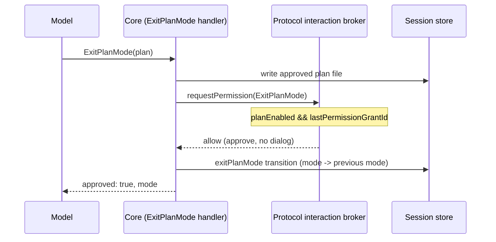

# Full Access plan auto-approval

**Status:** active  
**Owner:** CLI protocol interaction-broker maintainers  
**Authority:** contract  
**Scope:** ExitPlanMode approval under an existing Full Access grant  
**Updated:** 2026-10-12 08:39 (local time)  
**Verification:** source-only documentation review; approval scenarios were not rerun

## Problem

Plan mode always ends with a manual approval: the agent calls `ExitPlanMode`, the broker
routes the request to `requestExitPlanModeApproval`, and the client shows an approval
dialog. The user must click before implementation starts.

That gate is correct for `build` / `edit` / `plan` sessions. It is redundant in a **Full
Access** session. Full Access is an explicit, out-of-band user grant: the user has already
accepted that every tool in the current turn runs without a prompt (it sets the runtime
mode to `yolo` for the granted turn queue). Stopping afterwards on the plan dialog asks the
user to approve the same intent a second time.

So: when the session is in Full Access, `ExitPlanMode` must be approved automatically — the
plan is still persisted and the mode transition still happens, but no approval dialog is
shown.

## Product behavior

1. **Auto-approve only under Full Access.** When plan mode is active and the session holds a
   Full Access grant, an `ExitPlanMode` request resolves as an approval without any user
   interaction. The plan file is still written and the session still leaves plan mode.
2. **Full Access is the standing grant, not the current mode.** The signal is the runtime's
   `lastPermissionGrantId` — the same value the v4 projection uses to advertise a grant. It
   is set by `grantPermissionFullAccess` and cleared when the grant is superseded/resumed.
   The in-turn `mode === "yolo"` that the grant also writes is accepted as a secondary
   signal, but it is not sufficient on its own: switching the session into plan mode writes
   `mode` directly through the app facade, so a Full Access session can report
   `mode === "plan"` while the grant is still in force. Gating on `mode` alone made the plan
   dialog reappear for exactly those sessions.
3. **Everything else unchanged.** In `build`, `edit`, and `plan` sessions without a Full
   Access grant the approval dialog still appears exactly as before. Full Access does not
   suppress any other permission prompt on its own; it only removes the redundant *plan*
   confirmation.
4. **The grant is not enlarged.** Auto-approval does not grant new permissions, does not
   add allow rules, and does not change the plan's `allowedPrompts`. It only replaces the
   human answer to the existing `ExitPlanMode` request with "approve".
5. **Deterministic, not timed.** The approval is decided from session state at the moment
   the request is made. It is not a timeout, a background timer, or a race against the
   user's click.

## Ownership and boundary

The broker owns the decision, because the broker is the only place that already knows both
the request identity (`toolName === "ExitPlanMode"`) and the session state.

- `apps/mesa-code-cli/packages/bootstrap/src/mesa-code-protocol/interaction-broker.ts`,
  `createProtocolInteractionBroker.requestPermission`: owns the check. Before delegating to
  `requestExitPlanModeApproval`, it asks whether the session is in Full Access and returns
  an approval result directly when it is.
- The mode is read from the live session record
  (`context.sessions.get(sessionId).app.getMode()`), the grant marker from
  `record.app.runtime.lastPermissionGrantId`, and the plan flag from
  `runtime.getPlanEnabled()`. The source of truth is the persisted grant that
  `grantPermissionFullAccess` already writes; this spec adds no new persisted field.
- `ExitPlanMode`'s `ToolEntry` metadata (`needsApproval`, `requiresUserInteraction`) is
  **not** changed. It still declares that it needs approval; the broker only answers the
  request it raises. Keeping the metadata honest means the tool stays correct for every
  surface that does not consult session mode (CLI headless, tests, future callers).
- The UI is **not** changed. Because the broker never emits the interaction request, no
  dialog is rendered. No renderer-side "auto approved" special case is needed, and the
  existing `plan_approval` interaction path stays the only plan-approval surface.

Event order for a Full Access plan exit:

## Acceptance scenarios

1. Full Access session, plan mode enabled, agent calls `ExitPlanMode` → no approval request
   reaches the client, the broker returns an approval, the plan file is persisted, and the
   session leaves plan mode.
2. Full Access session that entered plan mode after the grant (so `mode` reads `"plan"`)
   → the plan is still auto-approved from the standing grant; the dialog does not reappear.
3. `build` session, plan mode enabled, agent calls `ExitPlanMode` → the approval dialog
   still appears and the user's answer decides the outcome.
4. `plan`-only session without a Full Access grant → the approval dialog still appears.
5. A Full Access `ExitPlanMode` approval adds no `permissionUpdates` / allow rules and
   leaves `allowedPrompts` exactly as the model provided them.
6. The auto-approval is derived from session state read at request time; no timer or
   timeout participates.
7. If the session record is unavailable, the broker falls back to the normal interactive
   approval path rather than failing closed with a denial.
