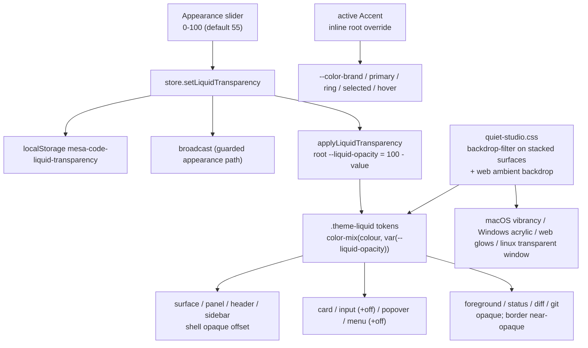

# Liquid Theme

**Status:** active specification  
**Owner:** shared UI Appearance and desktop chrome maintainers  
**Authority:** product contract and acceptance scenarios  
**Scope:** Liquid theme surfaces, glass transparency, and platform material presentation  
**Updated:** 2026-10-12 08:31 (local time)  
**Verification:** source implementation present; visual runtime behavior not verified in this update

Related: [`quiet-studio.md`](quiet-studio.md) (Appearance),
[`../theme-catalog.md`](../theme-catalog.md), [`black-theme.md`](black-theme.md).

This specification defines intended visual outcomes. Source presence alone does not establish a
shipped build, native-material appearance, contrast, or a successful runtime check.

## Problem

The pre-Liquid catalogue used opaque surfaces (`--color-background`, `--color-sidebar`,
`--color-panel`, `--color-card`), producing a flat dark/light UI with a different tint per theme.
Liquid addresses that design limitation using the material configuration already present in source:

- `packages/desktop/src/main/desktopWindowChrome.ts` creates the window with
  `vibrancy: "under-window"` on macOS and `backgroundMaterial: "acrylic"` on Windows,
  over a transparent `BrowserWindow`.
- `packages/ui/src/styles.css` already makes `html`, `body`, and `#root`
  `background: transparent !important` so that window material can show through.

An opaque `--color-background` on `[data-workspace-shell]` masks the material beneath it.
Current source instead supplies translucent `.theme-liquid` tokens; whether the resulting material
is visibly effective on each platform remains a runtime verification question.

A "Liquid" theme makes the intended frosted material real: dark, translucent surfaces
that let the desktop/backdrop read through, with a renderer-side `backdrop-filter` blur
on genuinely stacked surfaces and a colorful ambient backdrop for web where no window
material exists. It is the standard macOS/iOS liquid glass — translucent surfaces over
the real native window material — with no in-window wallpaper.

## Product rules

1. **Liquid is a selectable dark theme.** It joins the existing catalogue as the
   eleventh entry in Appearance. It resolves to `dark`, persists under the existing
   `mesa-code-theme` key, and is broadcast through the existing guarded path. No new
   store, protocol message, preference key, or migration is introduced.
2. **Surface tokens are strongly translucent; foreground tokens are opaque.** The
   background-family tokens (background, background-alt, header, panel, sidebar,
   surface, card, popover, input, menu, tab) are defined with
   `color-mix(in oklab, <color> N%, transparent)` at roughly 30-50% colour, so the
   backdrop shows through and visibly tints the glass — high enough opacity reads as a
   flat dark theme instead of glass. Foreground, semantic-status, diff, and git tokens
   stay opaque; borders stay near-opaque so panes keep a readable edge.
3. **Frost is scoped to genuinely stacked surfaces.** `backdrop-filter` (blur +
   saturation) plus a hairline top highlight is applied only where a surface overlaps
   other content — floating overlays (menus, popovers, dialogs, tooltips) and the mobile
   web sidebar drawer. In-flow shell regions are not blurred individually: neighbouring
   columns never overlap, and the window-level frost is the native material showing
   through the translucent tokens (macOS vibrancy / Windows acrylic), so per-panel blur
   would be cost without effect. Small chips, rows, and inline elements stay unblurred.
   There is no in-window wallpaper: Liquid stays see-through over the real desktop.
4. **The accent stays independent.** As with every other theme, selection, hover-lift,
   focus rings, and primary actions follow the active accent through the existing
   semantic tokens (`--color-selected`, `--color-hover`, `--color-card-selected`,
   `--color-tab-active`, `--color-accent`, `--color-brand`). Switching to Liquid never
   resets the chosen accent, and choosing an accent never changes Liquid surfaces.
5. **Platform behaviour is layered, not assumed.** macOS shows native vibrancy and
   Windows shows native acrylic beneath the translucent renderer surfaces. Linux keeps its
   transparent window, so Liquid there is translucent surfaces over the window base. Web
   has no window material, so it gets a colorful layered ambient backdrop (radial glows
   over a deep base) that the translucent shell tint-blurs and overlays frost directly —
   the translucency only reads as glass when there is something varied behind it, not a
   flat white canvas.
6. **Motion and reduced motion are unchanged.** Liquid adds no animation. The existing
   `prefers-reduced-motion` handling is untouched; blur and the static glow are not motion.
7. **Contrast holds.** Text, borders, cards, popovers, and inputs keep readable
   contrast against their translucent surfaces on every platform. Text-bearing layers
   (cards, inputs, popovers, menus) are mixed a little more opaque than the shell at any
   slider value, and overlays are capped so they never become fully opaque.
8. **Legacy values still normalize.** `liquid` is a valid persisted value and must not
   be silently normalized away; `light`/`dark` continue to map to Zai Light/Zai Dark.
9. **Glass strength is one user-adjustable preference.** A "Glass transparency" slider
   in Appearance — shown only while the Liquid theme is active — sets a single value in
   [0, 100] where 0 is opaque glass and 100 is fully see-through. The value persists under
   `mesa-code-liquid-transparency`, broadcasts across windows through the existing guarded
   appearance path, and is applied to the document root as the `--liquid-opacity`
   variable (the inverse colour amount) that every `.theme-liquid` token mixes against.
   One variable drives every surface, so the slider tunes the whole glass in step.

## State owner

- `packages/ui/src/useTheme.ts` owns the `Theme` union, `resolveTheme`, `isTheme`, and
  `applyTheme`. `liquid` is added to the catalogue dark list so the existing class
  toggling applies `theme-liquid` + `dark` with no new branch.
- `packages/ui/src/settings/settingsPageConfig.ts` owns the picker option list
  (`THEME_MODES`).
- `packages/ui/src/styles.css` owns the `.theme-liquid` token block. It is the single
  place that defines Liquid surfaces; every surface token mixes a colour with
  `var(--liquid-opacity)`.
- `packages/ui/src/lib/liquidTransparency.ts` owns the transparency value: its storage
  key (`mesa-code-liquid-transparency`), normalisation, load, and the
  `applyLiquidTransparency` writer that sets `--liquid-opacity` on the document root.
- `packages/ui/src/store/appearanceState.ts` owns the `liquidTransparency` field, its
  setter, and its membership in `APPEARANCE_BROADCAST_FIELDS`; `store/index.ts` owns the
  cross-window setter override, broadcast receive branch, and startup application.
- `packages/ui/src/settingsCodePreview.tsx` renders the slider (gated on `theme ===
"liquid"`), wired from `SettingsPage.tsx`.
- `packages/ui/src/quiet-studio.css` owns the `backdrop-filter` rule for stacked
  surfaces (floating overlays and the mobile drawer) and the web ambient backdrop, since
  it already owns `[data-workspace-shell]`.
- `packages/ui/src/accent.ts` owns the accent-derived inline root overrides. The Liquid
  block must not re-declare a token the accent writes, or the accent would stop working.

## Token relationship

## Acceptance scenarios

1. Selecting Liquid paints a strongly translucent dark workspace: the shell background
   is far from opaque, and the backdrop (macOS/Windows material, the web ambient glows,
   or the Linux window base) tints the sidebar, header, and panels. The result reads as
   glass, not as a flat dark theme (it must not resemble Midnight).
2. Foreground text, borders, and control outlines remain readable against the
   translucent surfaces; no text loses contrast.
3. Hover and selection on task rows, list items, menu items, and tabs are visually
   distinct from the background and carry the selected accent.
4. Choosing an accent (for example Rose) and then selecting Liquid keeps the Rose accent
   on hover, selection, focus rings, and primary buttons.
5. Reload after selecting Liquid restores the theme and its translucent palette;
   `mesa-code-theme` stores `liquid`.
6. Switching Liquid → Light → Liquid does not lose the stored accent, and Liquid never
   normalizes to Zai Dark.
7. `backdrop-filter` frost is applied only to stacked surfaces (floating overlays and
   the mobile drawer), not to every chip or inline element, and no animation is added.
8. On Web, the ambient backdrop gives the glass something to refract; on macOS/Windows
   the native material reads through; on Linux the transparent window shows through.
   Contrast holds on every platform.
9. With Liquid active, Appearance shows a "Glass transparency" slider. Dragging it
   changes every Liquid surface together — 0 makes the glass opaque, 100 makes it fully
   see-through (the desktop reads through) — the chosen value persists across reload
   (`mesa-code-liquid-transparency`), syncs to a second window, and text on cards, inputs,
   and popovers stays readable at both ends. The slider is not shown while another theme
   is active.

## Current source and verification boundary

Source review on 2026-10-12 found the `liquid` theme union/catalog entry, `.theme-liquid` token
block, scoped overlay/drawer frost and web ambient backdrop, Liquid-only Appearance slider, and
`liquidTransparency` persistence/application/broadcast wiring in the owners listed above. Desktop
chrome source configures macOS vibrancy and Windows acrylic. These are implementation observations,
not visual or release evidence.

No app launch, browser CSS computation, platform-material inspection, audio/interaction check, or
installer verification was performed for this documentation update. No current check pass is
claimed here; dated execution evidence belongs in [`../verification-log.md`](../verification-log.md).

Required verification:

- Run `pnpm typecheck`, `pnpm lint`, and `pnpm architecture:check --changed` when verifying code.
- Check theme recognition, dark resolution, preference normalization, picker membership, and
  transparency clamping/defaults with the focused tests.
- Verify Chromium computes the `--liquid-opacity` `color-mix`/`calc`/`min` combinations correctly;
  stylesheet text alone cannot prove computed colors.
- Inspect the running app on each supported platform: native material or web backdrop, live slider
  range, readable contrast, independent accent, reload persistence, and cross-window synchronization.
  Record platform and limitations separately from source checks.
