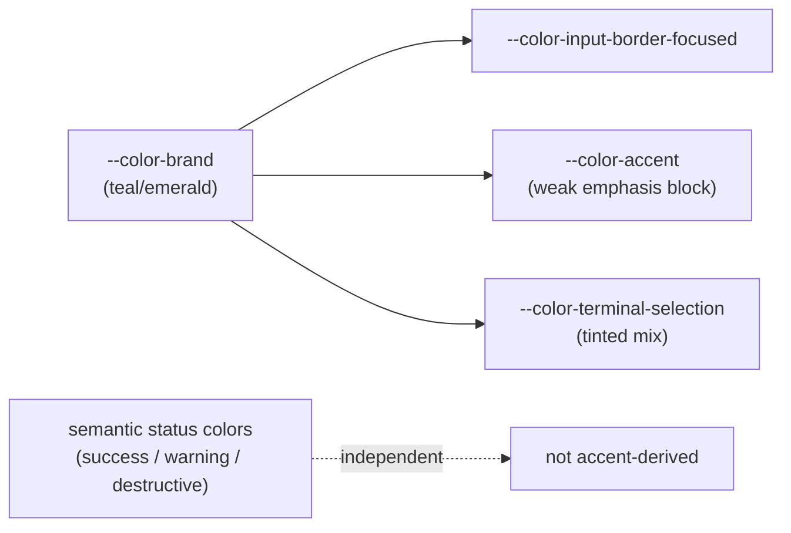

# Mesa Code Accent Identity

Status: Implemented

## Problem

The built-in themes resolved their brand color to the sky/blue family, which
does not read as Mesa Code's own identity.

- `.theme-zai-light` → `--color-brand: #000000`, with the light `:root` block falling back
  to `--color-brand: var(--color-sky-400)`.
- `.theme-zai-dark` → `--color-brand: var(--color-sky-500)`.

As long as the default themes are blue, Mesa Code has no distinct brand color.
The existing `docs/specs/mesa-code-branding.md` covers the *name*; nothing
covered the *color*.

A second defect was found while auditing the theme layer: the catalog in
`docs/theme-catalog.md` advertises ten selectable entries, but seven of them
(`black`, `midnight`, `ocean`, `forest`, `purple`, `rose`, `amber`) are unreachable from
the UI, and those seven override only four accent-adjacent tokens each. They never set
`--color-foreground`, `--color-card-border`, or `--color-popover-border`; they are
readable only because `resolveTheme()` maps them to the `dark` base, which still supplies
those tokens.

## Product behavior

1. **Mesa Code has its own accent.** The default built-in themes use a teal/emerald
   accent instead of sky/blue. This is the default identity a user sees on a fresh
   install and on `system`, `zai-light`, and `zai-dark`.
2. **The accent stays sparse.** `--color-brand` is used for key emphasis, active
   indicators, focus rings, and primary actions — as `DESIGN.md` already requires. The
   rework changes the hue of that token, not its usage policy. No surface becomes a
   full-bleed brand fill.
3. **Semantic colors are untouched.** Success, warning, destructive, diff, and the
   workflow status colors keep their current values. The accent is not a status color and
   must not be used as one.
4. **Dependent tokens follow the brand.** Tokens derived from the brand in the base
   blocks (`--color-accent`, `--color-input-border-focused`, and the terminal selection
   tint) must be re-derived from the new hue so the light and dark blocks stay internally
   consistent. Re-deriving means changing the token expression, not adding new tokens.
5. **Every catalog theme stays readable.** A theme is only valid if text, borders, cards,
   and popovers keep their contrast relationship to the surface. The seven catalog
   themes that never set those tokens must keep inheriting them from their base mode; the
   accent rework does not remove that inheritance.
6. **Unreachable themes are documented as unreachable, not silently shipped.** The
   seven catalog themes are not selectable from the UI in this change. `theme-catalog.md`
   must stop presenting them as user-selectable entries, or must state plainly that they
   are not yet exposed. Do not claim a picker that does not exist.

## Out of scope

- No accent picker is added. `docs/theme-catalog.md` currently claims "Accent selection is
  bundled with each theme"; that claim is corrected rather than implemented here.
- Internal identifiers are unchanged from the Mesa Code convention: the `mesa-code-theme`
  storage key, `@mesa-code/*` package scope, and `.mesaCode` storage directory all stay as
  they are, per `mesa-code-branding.md`.
- The UI typography constraint in `DESIGN.md` (the `text-ui-*` scale) is unaffected and
  is not relaxed by this change.
- Product language stays English-only (`en-US`), per `mesa-code-branding.md`. This change
  adds no translated strings and no language selector.

## Ownership and boundary

- `packages/ui/src/styles.css` owns the color tokens. The accent change is confined to
  the `:root`, `.dark`, `.theme-zai-light`, `.theme-zai-dark`, and `.theme-<catalog>`
  blocks. No component file is edited to achieve the hue change; components keep
  consuming semantic tokens.
- `packages/ui/src/useTheme.ts` owns theme resolution and the class applied to
  `document.documentElement`. It is not changed: the set of themes and their dark/light
  resolution already behave correctly.
- `docs/theme-catalog.md` owns the user-facing description of which themes exist. Its
  catalog table and the accent claim are corrected to match what the UI actually offers.
- No state owner is added. No new token family, no new persisted field, and no new store
  slice is introduced.

Token relationship after the change:

## Acceptance scenarios

1. A fresh install with no stored preference resolves to `zai-dark` and renders a
   teal/emerald accent, not blue.
2. `zai-light` renders the same accent family in its light-base form, with the focus ring
   and primary action matching the accent.
3. `system` follows the OS light/dark choice and uses the Mesa Code accent in both
   resolutions.
4. Text on `--color-card`, `--color-popover`, and `--color-surface` remains readable in
   `zai-light` and `zai-dark`, unchanged from before in contrast terms.
5. Success, warning, destructive, and diff colors are byte-for-byte identical to their
   pre-change values.
6. `docs/theme-catalog.md` no longer advertises a theme picker or accent picker that the
   UI does not provide.
7. Selecting a theme persists under the `mesa-code-theme` key, so users keep their
   stored preference across the upgrade.

## Verification

- `pnpm typecheck`, `pnpm lint`, and `pnpm architecture:check --changed` pass.
- `pnpm dev:web` renders the workspace with the new accent; the result is confirmed
  visually in a browser rather than asserted from the stylesheet alone.
