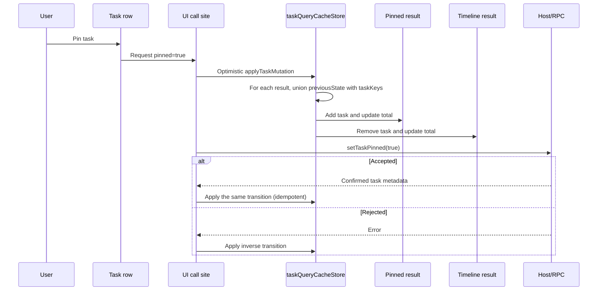

# Pinned Task Cache Membership

**Status:** active  
**Owner:** UI task-list cache maintainers  
**Authority:** contract  
**Scope:** optimistic, confirmed, and rollback pinned/archive query membership  
**Updated:** 2026-10-12 08:39 (local time)  
**Verification:** source-only documentation review; earlier verification notes below were not rerun

## Scope

This specification defines how the Renderer updates cached task-list queries when a task's
`pinned` or `archived` membership changes. It covers optimistic updates, server confirmation, and
rollback. It does not define Host persistence or the protocol used to publish membership.

Implementation: `packages/ui/src/store/taskQueryCacheStore.ts`

Regression coverage: `packages/ui/test/pinnedTaskCacheMembership.test.ts`

## Problem

Pinning a task from the timeline could make the row disappear instead of moving it to the Pinned
section.

The pin action supplied `previousState: { pinned: false, archived: false }` because the row was
being rendered by the timeline. That value is valid for the timeline, but it is not necessarily
valid for every cached query. When applied to the Pinned query, it caused the cache mutation to
conclude that the row was neither previously present nor newly included, so the Pinned result was
skipped.

`MesaCodeTaskMeta` does not contain `pinned` or `archived`. Those facts are maintained by membership
sets and used to build list results. Consequently, a mutation caller cannot be the sole authority
for a row's previous membership across all cached queries. Each query result's `taskKeys` is the
authoritative local record of whether that query already contains the row.

## Product rules

1. **One transition owner.** `applyTaskMutation` is the only function that moves a task between
   cached list results. Call sites provide old and new task metadata plus the intended next
   membership; they do not implement list-specific movement logic.
2. **Previous inclusion is determined per query.** A row is considered previously included when
   either the caller's `previousState` matches the query descriptor or the query's `taskKeys`
   contains the old or new entity key. The union preserves compatibility with callers that know
   the previous state while allowing the query's own cache to correct an incomplete claim.
3. **Next inclusion uses the intended next membership.** A query receives the row when the new task
   and `nextState` match its descriptor. Existing rows are removed before the new key is inserted,
   so retries and server confirmation cannot duplicate a row.
4. **Durable membership is limited to `pinned` and `archived`.** Timeline/workspace membership is
   derived as `!pinned && !archived`; it is not a field on `MesaCodeTaskMeta`.
5. **Pinning moves, rather than drops, a row.** Pinning removes the row from timeline/workspace
   results and adds it to Pinned. Unpinning performs the reverse. Archiving removes it from live
   results and adds it to Archived.
6. **Optimistic and confirmed updates have the same shape.** Applying the same transition after
   the server response is idempotent and must not cause a flicker or duplicate.
7. **Failures restore the previous membership.** A rejected pin/unpin operation applies the
   inverse transition and retains the existing failure notification behavior.
8. **Search results are not mutated by title-only matching.** Search descriptors are marked stale
   and refetched because their membership depends on server-side searchable content.

## Ownership and interface

### Renderer cache

`packages/ui/src/store/taskQueryCacheStore.ts` owns:

- the `resultsByQueryKey` cache;
- the per-query `taskKeys` membership record;
- task metadata merging and stable ordering; and
- the atomic `applyTaskMutation` transition.

`applyTaskMutation` accepts `previousTask`, `nextTask`, the caller's `previousState`, and the
intended `nextState`. The previous-state argument is evidence, not the sole source of truth. The
query's cached keys are also consulted for every non-search descriptor.

### Call sites

These components initiate the transition and must use the shared cache operation:

- `packages/ui/src/WorkspaceSidebarItem.tsx`
- `packages/ui/src/WorkspacePinnedTasksSection.tsx`
- `packages/ui/src/WorkspaceTimelineTasksSection.tsx`
- `packages/ui/src/WorkspaceGroupedTasksSection.tsx`

### Host boundary

The Host owns persistence and publication of `pinned` and `archived`. The Renderer mirrors those
facts in its list-query cache; it does not add a second durable membership store.

## Transition table

| Action | Previous membership | Next membership |
| --- | --- | --- |
| Pin | `pinned: false, archived: false` | `pinned: true, archived: false` |
| Unpin | `pinned: true, archived: false` | `pinned: false, archived: false` |
| Archive | any non-archived membership | `pinned: false, archived: true` |
| Unarchive | `pinned: false, archived: true` | `pinned: false, archived: false` |
| Rename or unread change | unchanged | unchanged |

The previous column describes the intended transition, not an assertion that every call site knows
the complete membership of every cached query. The cache still checks each result's `taskKeys`.

## Event order

## Acceptance scenarios

1. Pinning a timeline task adds it to Pinned and removes it from Timeline without dropping it from
   both lists.
2. Repeating a pin or applying server confirmation does not duplicate the row or corrupt totals.
3. Unpinning a Pinned task returns it to Timeline.
4. Archiving a Pinned task removes it from Pinned and Timeline and adds it to Archived.
5. If a caller reports `pinned: false` but the Pinned result already contains the row, the row
   remains in Pinned.
6. A cached but empty Pinned result receives a newly pinned row even when it has no prior `taskKeys`.
7. Search results become stale and are refetched rather than being locally reclassified by title.
8. A failed pin restores the previous list membership and preserves the existing failure toast.
9. Local and remote workspaces use the same cache transition semantics.

## Verification

The notes below record an earlier pass, including its branch-freshness limitation;
they are not a statement of the current checkout baseline or fresh test results.
Use the dated [verification log](../verification-log.md) for evidence context.

- `packages/ui/test/pinnedTaskCacheMembership.test.ts` covers pin, repeated pin, unpin, archive,
  insertion into an empty Pinned result, and the incorrect-`previousState` regression.
- The regression test fails when previous inclusion is inferred only from `previousState` and passes
  when cached `taskKeys` are included in the decision.
- Repository freshness could not be verified in this working tree: `main` is five commits behind
  `origin/main`, and the repository check requires a fast-forward update before work begins.
- This pass was documentation-only; no implementation or test command was rerun.
