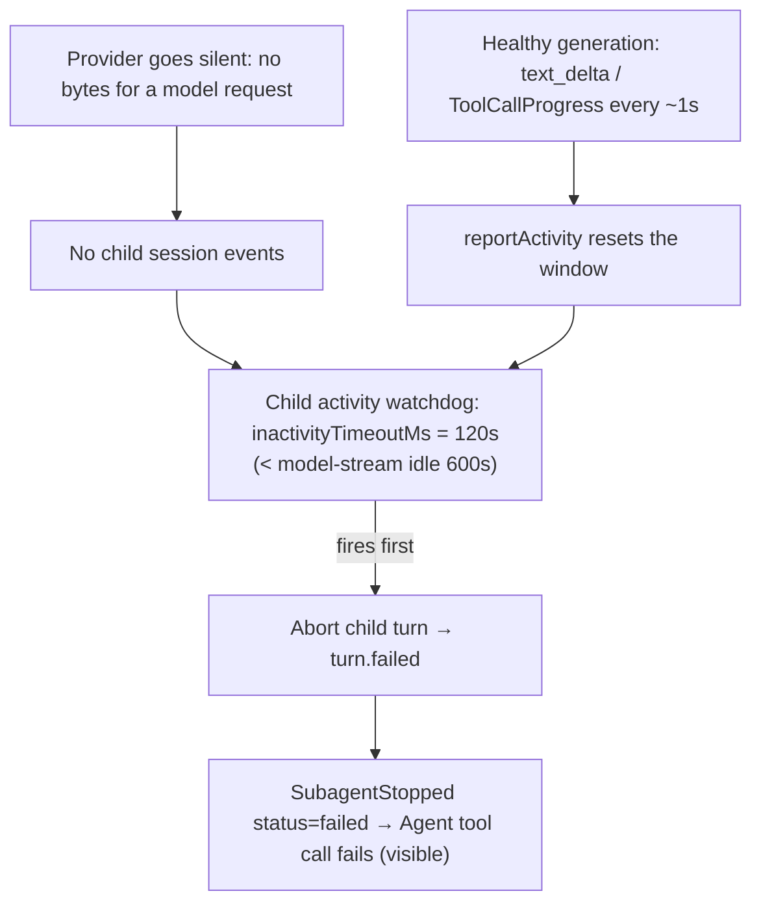

# Subagent stall detection

**Status:** active  
**Owner:** Agent runtime (`apps/mesa-code-cli/packages/core`), bootstrap runtime config  
**Authority:** contract  
**Scope:** bounded child-event inactivity, abort settlement, and foreground/background lifecycle boundaries  
**Updated:** 2026-10-12 08:39 (local time)  
**Verification:** source-only review; background handoff and override limitations remain below  
**Related:** [`proactive-skill-invocation.md`](proactive-skill-invocation.md), [`built-in-subagents.md`](built-in-subagents.md)

## Problem

A subagent could sit with no visible progress and no error for roughly ten minutes before
anything interrupted it. The reproduction: a `general-purpose` child in the `Kostku`
workspace called the `Skill` tool (which finished in 58 ms), then opened its **next model
request** and received **no bytes at all** from the provider. Nothing on screen changed —
no new tool call, no assistant text, no error — until the parent turn was cancelled at
9m24s, which propagated a `cancelled` failure down to the child.

The runtime already has an inactivity watchdog for foreground subagents, but it could never
fire first, for two mutually-masking reasons:

1. **The watchdog was armed at the same threshold as the thing it was supposed to guard.**
   The subagent watchdog defaulted to `DEFAULT_MODEL_STREAM_IDLE_TIMEOUT_MS` (600,000 ms):
   `core/src/subagent/runner.ts` used `options.inactivityTimeoutMs ?? DEFAULT_MODEL_STREAM_IDLE_TIMEOUT_MS`,
   and the desktop/bootstrap runtime never set `config.subagents.inactivityTimeoutMs`. So the
   watchdog and the model-stream idle timeout expired at exactly the same 10-minute mark — and
   the model-stream idle timeout, being the inner mechanism, won.
2. **The model-stream idle timeout is deliberately long and grows on retry.** Its default is
   600,000 ms and each retry adds 30 s (`resolveModelStreamIdleTimeoutMs`). A silently stalled
   provider stream is therefore "legitimately" allowed to idle for ~10 minutes.

The `Skill` call itself was never the cause: it completed normally, and the stall was the
following model request producing no stream events.

A single bounded fix covers both this stall and any other silent child, because the watchdog
fires on **any** gap in child session events — a stalled model request, a request that never
gets admitted, or a tool that never returns.

## Product rules

1. A foreground subagent that produces no child activity for the inactivity window is
   aborted and reported as a failure, instead of idling until the parent gives up.
2. The subagent inactivity window is **independently bound** and strictly shorter than the
   model-stream idle timeout, so the watchdog always fires before the stream-idle fallback.
3. **Healthy long work must never be killed.** Activity is defined as any child session
   event, which includes:
   - streamed assistant tokens (`text_delta` / `reasoning_delta`) — every delta is persisted
     as a `ModelStreaming` session event, so a long, _active_ generation keeps resetting the
     window; and
   - `ToolCallProgress` events, which long-running tools (Bash and background/foreground task
     output) emit roughly every second.
     A child is only judged stalled when it is genuinely silent.
4. The failure surfaces as a normal child failure (`SubagentStopped status=failed`, an error
   message on the `Agent` tool call), not a silent hang.
5. Background subagents and foreground subagents whose lifecycle is owned by the parent are
   both covered by the runner-level watchdog, so neither can idle forever.

## Ownership and boundary

- **Threshold owner:** `context.subagents.inactivityTimeoutMs`
  (`core/src/runtime/types.ts`). The desktop/bootstrap runtime (`bootstrap/src/app/runtime-config.ts`)
  sets it to `DEFAULT_SUBAGENT_INACTIVITY_TIMEOUT_MS` (120,000 ms). The core runner keeps a
  defensive default of the same constant so a caller that omits it cannot fall back to the
  longer model-stream idle.
- **Detector owner:** `createSubagentActivityWatchdog`
  (`core/src/subagent/runner.ts`). It is the single place that decides "the child went quiet";
  it is reset by `reportActivity`, which the child runtime invokes on every child session event
  (`core/src/runtime/methods/subagent.ts`). No new timer, store, or event is introduced.
- **UI surfacing:** the existing model-retry control (`apiRetry`) already renders a stall
  reason code in the main conversation; it is out of scope here. A subagent step already
  shows its terminal failed state, which is the user-visible result of this fix.

## Diagram

## Acceptance scenarios

1. A foreground subagent that emits no child session event for `inactivityTimeoutMs`
   (default 120,000 ms) is aborted with a `ToolTimeout` child error and reported as
   `SubagentStopped status=failed`; the `Agent` tool call returns a failure instead of
   hanging.
2. A healthy generation that streams tokens or emits tool-progress events for longer than
   `inactivityTimeoutMs` is **not** aborted, because each event resets the window.
3. The subagent inactivity window is strictly less than the model-stream idle timeout, so
   the watchdog is the first mechanism to fire on a silent child.
4. An explicit `config.subagents.inactivityTimeoutMs` overrides the default; a non-positive or
   non-finite value disables the watchdog (unchanged handling).
5. No new persistent state, no new session event type, and no second timer are introduced.

## Current source boundary and verification

[`runner.ts`](../../apps/mesa-code-cli/packages/core/src/subagent/runner.ts)
starts the foreground watchdog before child session readiness. It guards both the
ready gate and completion promise with `guardSubagentPromiseWithAbort`, so an abort
can reject the outer wait even if the child promise never settles. The direct
`runBackgroundAgent` path also starts a watchdog before readiness and uses the
abort guard. Child session events call `reportActivity` through
[`runtime/methods/subagent.ts`](../../apps/mesa-code-cli/packages/core/src/runtime/methods/subagent.ts).

Two limitations prevent claiming all acceptance rules are complete:

- Foreground-to-background handoff stops `activityWatchdog` and follows the raw
  `completionPromise`; that branch does not install the direct-background watchdog.
  Rule 5's coverage of every background lifecycle is therefore not established.
- Explicit positive `inactivityTimeoutMs` values are not clamped below the model
  idle timeout; non-finite/non-positive values disable detection. The 120,000 ms
  default is below the 600,000 ms model default, but the absolute "always first"
  rule does not hold for arbitrary overrides. Keep the intended bound pending a
  product/configuration decision, rather than silently changing it.

Activity means observed events, not proof of useful work. A silent but healthy
operation can exceed the window; a noisy stuck operation can keep resetting it.
Neither case should be described as guaranteed safe solely from this detector.

The existing `apps/mesa-code-cli/packages/core/test/subagent-inactivity-watchdog.test.ts`
checks silent-child abort, activity resets, and independent default constants. It
was not rerun here. Future checks must also cover setup before readiness, a child
that ignores abort, direct background launch, foreground-to-background handoff,
parent cancellation, and disabled/large overrides. Record runtime visibility of
`SubagentStopped` separately from promise settlement. A normal completed Skill
call does not itself diagnose the next silent model request.

## Out of scope

- The model-stream idle timeout value for the main (non-subagent) session.
- Reading or tailing a child's output file to detect progress.
- Recovering (rather than failing) a stalled child; a stalled child is terminal, and the
  parent may relaunch it.
