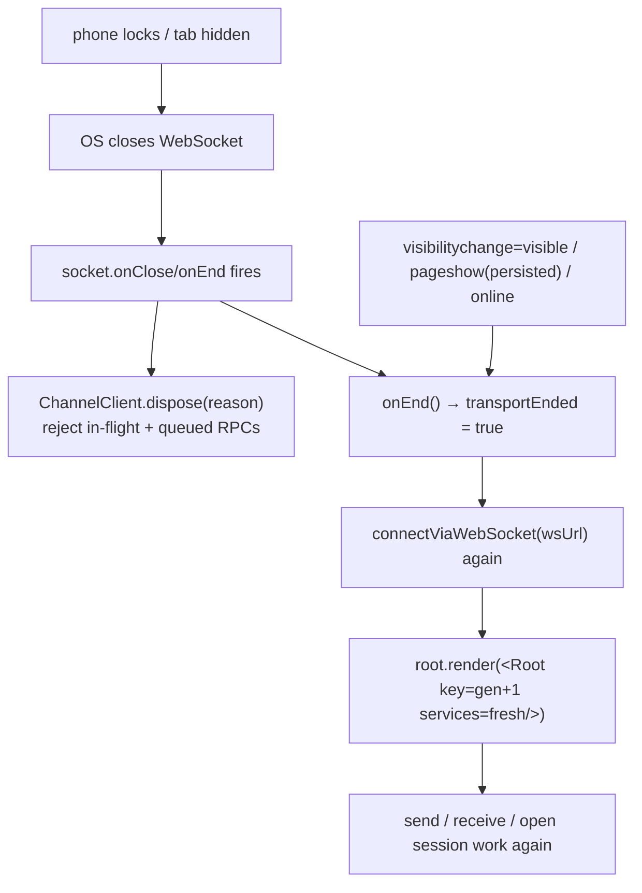

# Web Remote Reconnect

**Status:** active  
**Owner:** web entry and client transport maintainers  
**Authority:** contract  
**Scope:** fail-closed established WebSockets and web/LAN client reconnect lifecycle  
**Updated:** 2026-10-12 08:39 (local time)  
**Verification:** source-only review; real-phone resume/BFCache checks were not run

Related: [LAN mirror](local-network-access.md), [Quiet Studio](quiet-studio.md),
[mobile web layout](quiet-studio-mobile-web-layout.md).

## Problem

The web/LAN client (`http://<ip>:<port>/` on a phone, attaching to the desktop's existing
Host over the `/ws` `web-remote-replayable` endpoint) opened its WebSocket **once** at
bootstrap and never again. `connectViaWebSocket` was called with an empty `onClose` hook,
`ISocket.onClose`/`onEnd` had **no subscriber**, and no `visibilitychange` / `pagehide` /
`pageshow` / `online` handler existed on the web path.

Consequences observed on a phone:

- Locking the screen or switching to the home screen / another app makes the OS close (or
  the browser freeze) the WebSocket. When the page resumes it keeps a dead socket:
  `wrapBrowserWebSocket.write` silently drops every outbound frame (`readyState !== OPEN`),
  and `ChannelClient` leaves every request pending **forever** (no reject, no timeout).
- The user cannot send chat, receive chat, or open a session; only a full page reload
  (which re-runs `bootstrapWebApp` → `connectViaWebSocket`) restores the page.

The replayable/resync machinery in `conversationProjectionStore`/`workspaceConnectionRegistry`
is **event-driven over a live transport** and cannot fire when the socket is dead, so it
cannot self-heal a dropped transport. The missing piece is a transport-lifecycle owner.

## Product rules

1. **An established transport that ends must fail closed.** When the socket closes or
   errors, every in-flight and queued RPC is rejected immediately (so callers' error paths
   run) instead of hanging. No request may wait on a dead socket.
2. **The web client reconnects on resume.** When the page becomes visible again
   (`visibilitychange` → visible), is restored from the back/forward cache (`pageshow`,
   including `persisted`), or the network returns (`online`), the client re-establishes the
   WebSocket and continues, without the user reloading the page by hand.
3. **Recovery is an app remount on a fresh accessor, not a page reload.** Because the
   `ProxyChannel.toService` proxies capture their channel by value, a reconnect mints a new
   accessor and the tree is remounted (a `key` bump) so every consumer re-reads the fresh
   services rather than silently reusing the dead one. The URL, and thus the session the
   Host owns, is preserved.
4. **Transport recovery only; it does not change stream semantics.** This is purely
   re-establishing the socket. The `desktop-continuous` and `web-remote-replayable`
   delivery paths, the single Host/session runtime for mobile, owner/lease, and the
   sequence-checked projection are unchanged. No second Agent, Host, or remote session is
   created for mobile.
5. **No double connection.** A reconnect is guarded so overlapping resume events, or a
   socket that dies while the page stays visible, cannot open two sockets. An end event
   from a superseded socket is ignored by connection identity.
6. **No new store, protocol, or persistence.** The reconnect owner lives in the web entry;
   it adds no store field, no protocol message, and no migration.

## State owner

- `packages/client/src/websocket.ts` owns the transport contract: `createWebSocketServiceAccess`
  builds the accessor for an established socket and wires `socket.onClose`/`onEnd` →
  `ChannelClient.dispose` (fail-closed) plus the `onEnd` signal; `WebSocketConnectionOptions.onEnd`
  is the "an established transport died" callback.
- `packages/web/src/main.tsx` owns the reconnect policy: it holds the accessor and a
  generation counter, mounts the app on each fresh accessor, and reconnects on the resume
  events. It is the single owner of "which socket is live".
- The Host/server side (`packages/server/src/http.ts`) is unchanged: it already disposes the
  per-connection scope on socket close.

## Token / flow

## Current recovery limits and runbook

The problem section records the pre-reconnect failure, not the current complete
transport implementation. In
[`main.tsx`](../../packages/web/src/main.tsx), `createWebAppController` subscribes
to `visibilitychange`, `pageshow`, and `online` after the initial connection.
Only an observed end sets `transportEnded`; resume alone does not replace a socket
that still appears live. Visible end events schedule one reconnect attempt,
serialized by `reconnectInFlight`; late events are ignored by connection ID.
A failed attempt leaves `transportEnded` set for the next resume event. There is
no periodic retry, heartbeat-based dead-socket detection, or initial-connect
timeout in this owner. Initial bootstrap failure shows the bootstrap error view.

These limits leave an unobserved frozen/half-open socket, or a failed visible
reconnect without a later resume event, outside demonstrated automatic recovery.
Do not weaken the no-manual-reload acceptance outcome to hide those gaps.

The remount reuses resolved bootstrap workspace/task inputs and Host-owned
session state. Preserving the URL is not proof that an in-memory task selection
made after bootstrap is restored; verify the actual selected task after recovery.
The controller keys `Root`, not every surrounding provider. Check all service
consumers for stale accessors in a future interaction test.

For future isolated phone/web verification:

1. Attach to the intended existing Host; record workspace identity/session without
   credentials. Open a task other than the bootstrap task.
2. Lock/unlock, background/foreground, restore BFCache, then interrupt/recover the
   network. Check send rejection during the dead transport and incoming updates
   after recovery. Count live sockets; reject duplicates.
3. Test a failed reconnect and a socket that does not emit close/error. Record
   whether another resume or manual reload is needed; do not report automatic
   retry that the source does not provide.
4. Confirm task selection, drafts, workspace identity, and the same Host/session.
   Separately verify the unchanged desktop-continuous delivery path.

`packages/client/test/websocketFailClosed.test.ts` exercises an established fake
socket and single-fire end callback. It does not exercise the controller, real
browser suspension, BFCache, or same-task restoration.

## Acceptance scenarios

1. With the phone mirror open and a session visible, locking the screen and returning leaves
   the page usable: sending a message succeeds and incoming updates resume, without a manual
   reload.
2. Switching the phone to the home screen (or another app) and returning has the same effect.
3. A restored BFCache page (`pageshow` with `persisted`) recovers; the stale socket's queued
   close is observed and one reconnect happens (not two).
4. While the socket is dead and before a reconnect completes, a send does not hang silently:
   the RPC fails fast (the request rejects), so the existing error handling can run.
5. Recovery keeps the same Host and session: no second Agent/Host/session is started, and the
   conversation/session the phone was viewing is the one it returns to.
6. A transient drop while the page stays visible also recovers without user action.
7. The `desktop-continuous` desktop path is unaffected.

## Verification

- After implementation changes, run `pnpm typecheck`, `pnpm lint`, and `pnpm architecture:check --changed`; record actual results in the [verification log](../verification-log.md). None was run for this documentation-only review.
- A focused unit test (`packages/client/test/websocketFailClosed.test.ts`) pins the fail-closed
  contract and the single-fire `onEnd` with a fake socket.
- The reconnect on a real phone (screen lock / background / BFCache) is a runtime result and is
  reported separately from source checks; it is not asserted from the stylesheet or source alone.
